# Income Tax Filing Assistant (India)
**A Full-Stack Academic Project for Income Tax Estimation & Regime Optimization**

[](#technology-stack)
[](#backend-architecture)
[](#database-schema)
[](#xampp-step-by-step-setup)

---

## 1. Project Abstract & Overview

The **Income Tax Filing Assistant** is a web-based financial decision-support system designed to simplify income tax estimation, Chapter VI-A deduction optimization, and document preparation for Indian taxpayers. 

Following the implementation of the dual tax structure in India, choosing between the **Old Tax Regime** (featuring itemized exemptions like Section 80C, 80D, and 24b) and the revised **New Tax Regime** (introduced under Section 115BAC with lower tax slabs and higher standard deductions) has become complex. This project provides:
- Real-time side-by-side comparative tax calculations.
- Exact statutory rebate computations under **Section 87A** (including marginal relief).
- Automatic application of the **₹75,000 Standard Deduction** for FY 2024-25 (Union Budget 2024 revision).
- Multi-head income recording (Salary, House Property, Capital Gains, Business, Other Sources).
- ITR pre-filing document readiness checklist (Form 16, 26AS, AIS/TIS, interest certificates).
- Multi-year calculation history snapshots with a printable tax computation sheet.

> **Statutory Notice:** This software is an educational tax planning and estimation simulator developed for college project demonstration. It does not submit tax returns directly to the Income Tax Department e-Filing portal.

---

## 2. Technology Requirements Compliance

| Layer | Requirement | Implementation |
|---|---|---|
| **Frontend** | HTML5, CSS3, Vanilla JS only | **Zero external frontend frameworks**. No React, Angular, Vue, Next.js, TypeScript, Bootstrap, or Tailwind CSS. Custom responsive CSS grid, flexbox, and SVG icons. |
| **Backend** | PHP | Object-Oriented PHP 8.x with PDO, prepared statements, and session authentication. |
| **Database** | MySQL / MariaDB | Relational database (`tax_assistant`) with foreign key constraints, indexes, and prepared queries. |
| **Offline Execution** | XAMPP | Ready to run in `C:\xampp\htdocs\income-tax-assistant\` via Apache and MySQL. |
| **Online Deployment** | PHP Hosting / Vercel | Native support for Apache/cPanel/Hostinger + `vercel.json` configuration for `@vercel/php`. |

---

## 3. Functional Modules

### Module 1: Home Page & Project Introduction (`index.php` / `index.html`)
- Project overview, core capabilities, and verified statutory tax slabs reference.
- **Interactive Quick Estimator Widget**: Allows visitors to input their gross income and deductions on the landing page to instantly see an Old vs New regime estimate before logging in.
- Legal disclaimer and student capstone metadata.

### Module 2: Authentication System (`login.php`, `register.php`, `api/auth.php`)
- Secure registration with client-side and server-side validation:
  - **PAN Card Validation**: Enforces standard format (`[A-Z]{5}[0-9]{4}[A-Z]{1}`).
  - **Date of Birth Calculation**: Automatically categorizes taxpayers into General (<60 yrs), Senior Citizen (60–79 yrs), or Super Senior Citizen (80+ yrs).
- Password hashing using PHP's native `password_hash($pass, PASSWORD_BCRYPT)`.
- **1-Click College Demo Button**: Automatically pre-fills evaluation credentials (`demo@taxassistant.local` / `Demo@1234`).
- Session-based authorization with session fixation protection.

### Module 3: Financial Dashboard (`dashboard.php`, `assets/js/dashboard.js`)
- **4 Key Metric Summary Cards**: Gross Total Income, Total Deductions Claimed, Net Taxable Income, and Best Estimated Tax Liability.
- **Live Regime Comparison Winner Banner**: Highlights the optimal regime (e.g., *"🎉 New Tax Regime saves you ₹45,500"*).
- **Multi-Head Income Distribution Bars**: Visual breakdown of income proportions across Salary, House Property, Capital Gains, Business, and Other Sources.
- **Filing Readiness Progress Tracker**: Real-time progress bar reflecting document checklist completion.

### Module 4: Income Entry & Management (`income.php`, `assets/js/income.js`)
- Full CRUD management across the **5 Statutory Heads of Income**:
  1. *Salary / Allowances* (Basic, HRA, Special Allowance, Bonus)
  2. *House Property* (Rental income from residential or commercial property)
  3. *Capital Gains* (STCG / LTCG from stocks, mutual funds, real estate)
  4. *Profits & Gains of Business or Profession (PGBP / Freelancing)*
  5. *Income from Other Sources* (Savings interest, FD interest, Dividends)
- Modal dialogs for adding and editing records.
- **Client-Side CSV Export**: Generates an instant downloadable spreadsheet (`Income_Details_FY.csv`) without external libraries.

### Module 5: Income Tax Calculator (`calculator.php`, `assets/js/calculator.js`)
- Configurable controls:
  - Financial Year selector (`FY 2024-25` / `FY 2023-24`).
  - Age Category (`General`, `Senior Citizen`, `Super Senior Citizen`).
  - Salaried status toggle for Standard Deduction eligibility.
- Auto-fill button: Loads recorded income and deductions into what-if simulation fields.
- **Side-by-side Regime Comparison Cards**:
  - Gross Income $\to$ Standard Deduction $\to$ Chapter VI-A Deductions $\to$ Net Taxable Income $\to$ Base Tax $\to$ Section 87A Rebate $\to$ Surcharge $\to$ 4% Health & Education Cess $\to$ Final Tax Payable.
- Step-by-step slab breakdown tables showing exact taxable income and tax generated in each bracket.
- "Save to History" action to preserve calculations.

### Module 6: Deduction Management (`deductions.php`, `assets/js/deductions.js`)
- Statutory tracking under Chapter VI-A:
  - **Section 80C**: EPF, PPF, ELSS, Life Insurance, Tuition Fees (Statutory limit: ₹1,50,000).
  - **Section 80D**: Health Insurance for self, family, and senior citizen parents (Up to ₹1,00,000).
  - **Section 80CCD(1B)**: Additional NPS Tier-1 contribution (Exclusive ₹50,000 limit).
  - **Section 24(b)**: Home loan interest on self-occupied property (Up to ₹2,00,000).
  - **Section 80E**: Higher education loan interest (No upper limit).
  - **Section 80G**: Donations to eligible charitable institutions / relief funds.
  - **Section 80TTA / 80TTB**: Savings bank interest exemptions.
- Visual statutory cap indicator cards displaying claimed vs eligible amounts.

### Module 7: Tax Document Checklist (`checklist.php`, `assets/js/checklist.js`)
- Tracks required verification documents:
  - Form 16 (Part A & Part B)
  - Form 26AS & AIS / TIS Statement
  - PAN & Aadhaar Linking Confirmation
  - Bank Account Interest Certificates
  - Housing Loan Interest Certificates
  - Section 80C, 80D, and NPS Receipts
  - Broker Capital Gains Summary
- Status states: `Pending`, `In Hand`, `Verified`, `Not Applicable`.
- Readiness percentage progress bar.
- Custom document addition and notes editing.

### Module 8: Calculation History (`history.php`, `assets/js/history.js`)
- Chronological table of saved calculations.
- **Official-Style Printable Computation Statement**: Formatted for browser printing or saving as a clean, professional PDF tax report.
- Delete and review actions.

### Module 9: User Profile & Security (`profile.php`, `assets/js/profile.js`)
- User profile management with live age-group classification badge.
- Secure password change functionality.
- **Danger Zone**: One-click data reset option to wipe simulation data and start fresh.
- Secure session destruction on logout.

---

## 4. Verified Indian Tax Calculation Rules

### Financial Year 2024-25 (Assessment Year 2025-26) - Budget 2024 Revised

#### New Tax Regime (Section 115BAC)
- **Standard Deduction**: ₹75,000 for salaried taxpayers.
- **Tax Slabs**:
  - ₹0 to ₹3,00,000: **NIL**
  - ₹3,00,001 to ₹7,00,000: **5%**
  - ₹7,00,001 to ₹10,00,000: **10%**
  - ₹10,00,001 to ₹12,00,000: **15%**
  - ₹12,00,001 to ₹15,00,000: **20%**
  - Above ₹15,00,000: **30%**
- **Rebate u/s 87A**: If net taxable income $\le$ ₹7,00,000, 100% of tax is rebated (Effective zero tax for salaried individuals earning up to ₹7.75 Lakhs).
- **Marginal Relief**: If taxable income marginally exceeds ₹7,00,000, tax cannot exceed the excess income over ₹7,00,000.
- **Cess**: 4% Health & Education Cess on (Tax + Surcharge - Rebate).

#### Old Tax Regime
- **Standard Deduction**: ₹50,000 for salaried taxpayers.
- **Basic Exemption Limit**:
  - General (< 60 yrs): ₹2,50,000
  - Senior Citizen (60–79 yrs): ₹3,00,000
  - Super Senior Citizen (80+ yrs): ₹5,00,000
- **Tax Slabs (General Individual)**:
  - ₹0 to ₹2,50,000: **NIL**
  - ₹2,50,001 to ₹5,00,000: **5%**
  - ₹5,00,001 to ₹10,00,000: **20%**
  - Above ₹10,00,000: **30%**
- **Rebate u/s 87A**: If net taxable income $\le$ ₹5,00,000, rebate up to ₹12,500 (Zero tax up to ₹5,00,000 taxable income).
- **Deductions**: Full Chapter VI-A deductions allowed (80C up to ₹1.5L, 80D, 80CCD, Sec 24b up to ₹2L, etc.).

---

## 5. Database Schema Architecture

The database `tax_assistant` consists of 5 normalized tables:

```mermaid
erDiagram
    users ||--o{ income_details : "records"
    users ||--o{ deductions : "claims"
    users ||--o{ tax_calculations : "saves"
    users ||--o{ documents : "manages"

    users {
        int id PK
        varchar name
        varchar email UK
        varchar password_hash
        varchar pan_number
        date dob
        varchar phone
        varchar default_fy
        timestamp created_at
    }

    income_details {
        int id PK
        int user_id FK
        varchar financial_year
        enum category
        varchar subcategory
        decimal amount
        text description
        timestamp created_at
    }

    deductions {
        int id PK
        int user_id FK
        varchar financial_year
        varchar section
        decimal amount
        text notes
        timestamp created_at
    }

    tax_calculations {
        int id PK
        int user_id FK
        varchar financial_year
        decimal gross_income
        decimal total_deductions_old
        decimal total_deductions_new
        decimal taxable_income_old
        decimal taxable_income_new
        decimal net_tax_old
        decimal net_tax_new
        varchar recommended_regime
        longtext calculation_details
        timestamp created_at
    }

    documents {
        int id PK
        int user_id FK
        varchar financial_year
        varchar doc_name
        enum status
        text notes
        timestamp created_at
    }
```



---

## 6. XAMPP Step-by-Step Setup Guide

Follow these steps to run the project in XAMPP on Windows:

### Step 1: Place the Project in XAMPP `htdocs`
Ensure the project folder is located at:
```
C:\xampp\htdocs\income-tax-assistant\
```

### Step 2: Start Apache and MySQL in XAMPP
1. Open the **XAMPP Control Panel** (`C:\xampp\xampp-control.exe`).
2. Click **Start** next to **Apache**.
3. Click **Start** next to **MySQL**.
*(Both service modules should show green status indicators).*

### Step 3: Import the Database Schema
You can import the database using either **phpMyAdmin** or the **Command Prompt**:

#### Option A: Using phpMyAdmin (Browser)
1. Open your browser and navigate to `http://localhost/phpmyadmin/`.
2. Click on the **Import** tab at the top.
3. Click **Choose File** and select `C:\xampp\htdocs\income-tax-assistant\database.sql`.
4. Click **Import** at the bottom.
*(The database `tax_assistant` will be created with all 5 tables and pre-loaded sample data).*

#### Option B: Using Command Prompt / PowerShell
Open PowerShell or Command Prompt and execute:
```powershell
C:\xampp\mysql\bin\mysql.exe -u root -e "source C:/xampp/htdocs/income-tax-assistant/database.sql;"
```

### Step 4: Access the Application
Open your web browser and navigate to:
```
http://localhost/income-tax-assistant/
```

---

## 7. Pre-Loaded Evaluation Credentials

The database comes pre-configured with a realistic taxpayer demo profile for presentations:

| Field | Value |
|---|---|
| **Email Address** | `demo@taxassistant.local` |
| **Password** | `Demo@1234` |
| **Taxpayer Name** | Ramesh Kumar |
| **PAN Card** | `ABCDE1234F` |
| **Pre-loaded Income** | ₹14,25,000 (Salary, House Property, Interest) |
| **Pre-loaded Deductions**| ₹3,65,000 (80C, 80D, NPS, Home Loan Interest) |
| **Checklist** | 8 standard compliance documents with realistic statuses |

> You can also click the **"Use Demo"** button on the Login page to pre-fill these credentials instantly.

---

## 8. Alternative Quick Run via PHP Built-in Server

If Apache is occupied on port 80 by another service, you can run the project using PHP's built-in web server:

```powershell
cd C:\xampp\htdocs\income-tax-assistant
C:\xampp\php\php.exe -S 127.0.0.1:8000
```
Then visit:
```
http://127.0.0.1:8000/
```

---

## 9. Online Deployment Considerations

### Standard PHP Hosting (cPanel, Hostinger, Shared Hosting)
1. Upload all files to your server's `public_html` directory.
2. Create a MySQL database and user in your hosting control panel.
3. Import `database.sql` via phpMyAdmin.
4. Update `DB_NAME`, `DB_USER`, and `DB_PASS` in `config/database.php`.

### Vercel Serverless Deployment
- The repository includes a `vercel.json` file configured with the `@vercel/php` serverless runtime.
- For database connectivity on Vercel, connect `config/database.php` to a cloud MySQL database such as PlanetScale, Supabase (with MySQL wrapper), Aiven, or AWS RDS by configuring environment variables.

---

## 10. College Project Defense & Viva Q&A Guide

Common technical and domain questions asked during college evaluations:

**Q1: Why did you not use frontend frameworks like React or Bootstrap?**
> **Answer:** Building the user interface with pure HTML5, CSS3, and vanilla JavaScript demonstrates core web fundamentals, eliminates bloated bundle sizes, ensures zero runtime dependency failures, and delivers superior rendering performance without virtual DOM overhead.

**Q2: How does the application prevent SQL Injection?**
> **Answer:** All database interactions in `api/*.php` use PHP Data Objects (PDO) with prepared parameterized statements (`$stmt->prepare()` and `$stmt->execute()`) and `PDO::ATTR_EMULATE_PREPARES => false`. User inputs are never concatenated directly into SQL queries.

**Q3: How is password security handled?**
> **Answer:** Passwords are never stored in plaintext. They are encrypted using the cryptographic `PASSWORD_BCRYPT` algorithm via `password_hash()`, which incorporates individual salt generation and work factors, verified during login with `password_verify()`.

**Q4: How does the system handle user data isolation?**
> **Answer:** Every data retrieval, insertion, modification, and deletion query strictly filters by the authenticated session identifier (`WHERE user_id = :uid`), preventing unauthorized cross-user data access (Horizontal Privilege Escalation).

**Q5: How does the New Regime handle Section 87A rebate compared to the Old Regime?**
> **Answer:** In the Old Regime, Section 87A provides a maximum rebate of ₹12,500 if taxable income does not exceed ₹5,00,000. In the New Regime (FY 2024-25), the rebate covers 100% of tax on taxable incomes up to ₹7,00,000. Coupled with the ₹75,000 standard deduction, a salaried employee with gross income up to ₹7,75,000 pays zero tax under the New Regime.

---

## 11. Directory Structure

```
income-tax-assistant/
├── assets/
│   ├── css/
│   │   ├── style.css           # Core typography, buttons, tables, reset, toasts, modals
│   │   ├── dashboard.css       # Sidebar, topbar, metric cards, regime comparison styles
│   │   └── auth.css            # Split authentication layouts (Login / Register)
│   └── js/
│       ├── api.js              # Universal fetch wrapper, toast alerts, session handlers
│       ├── dashboard.js        # Dashboard metrics, income breakdown bars, readiness progress
│       ├── income.js           # 5-Head income CRUD, category suggestions, CSV export
│       ├── deductions.js       # Chapter VI-A deductions CRUD, statutory cap indicators
│       ├── calculator.js       # Slabs calculation, rebate 87A, side-by-side comparator
│       ├── checklist.js        # Document readiness toggles, custom items, notes
│       ├── history.js          # Past calculations, printable computation sheet modal
│       └── profile.js          # Age group classification, password change, reset
├── config/
│   ├── database.php            # PDO MySQL connection with auto-table initialization
│   └── tax_rules.php           # Verified Indian Income Tax slab engine (FY 24-25 & 23-24)
├── includes/
│   ├── auth_check.php          # Session verification helpers for pages and APIs
│   ├── header.php              # Common HTML head and layout wrapper
│   ├── sidebar.php             # Responsive navigation sidebar with active indicators
│   ├── topbar.php              # Financial Year dropdown, quick actions, user chip
│   └── footer.php              # Global toast container, script loaders
├── api/
│   ├── auth.php                # Login, register, session-check, logout
│   ├── income.php              # Income CRUD endpoints
│   ├── deductions.php          # Deductions CRUD endpoints
│   ├── calculator.php          # Compute and snapshot save endpoints
│   ├── checklist.php           # Document checklist operations
│   ├── history.php             # History retrieval and deletion endpoints
│   └── profile.php             # User profile, password update, data reset
├── database.sql                # Complete MySQL schema + sample data
├── index.php / index.html      # Landing page with interactive quick estimator
├── login.php / login.html      # Login page with demo credentials button
├── register.php / register.html# Registration with PAN & DOB validation
├── dashboard.php / .html       # Main financial dashboard
├── income.php / .html          # Income sources management
├── deductions.php / .html      # Deductions management
├── calculator.php / .html      # Full interactive tax calculator
├── checklist.php / .html       # Filing readiness checklist
├── history.php / .html         # Calculation history and printable statement
├── profile.php / .html         # Profile and security settings
├── vercel.json                 # Vercel deployment configuration
└── README.md                   # Complete academic documentation & viva guide
```

---
**Project Status:** Functional, tested, and ready for college project demonstration in XAMPP.
